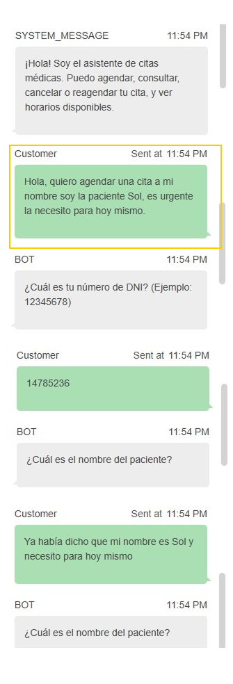
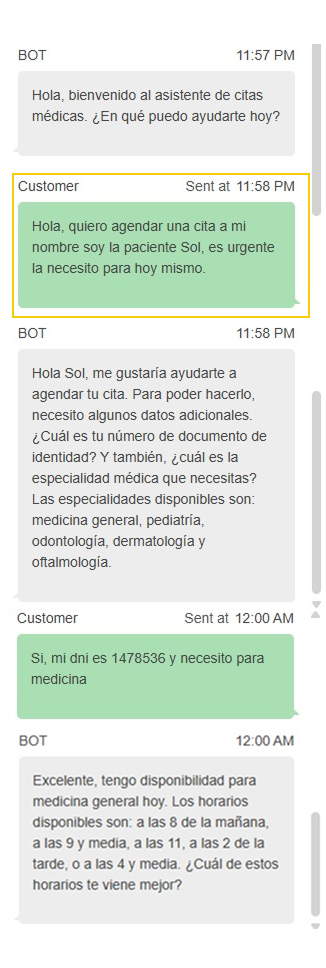
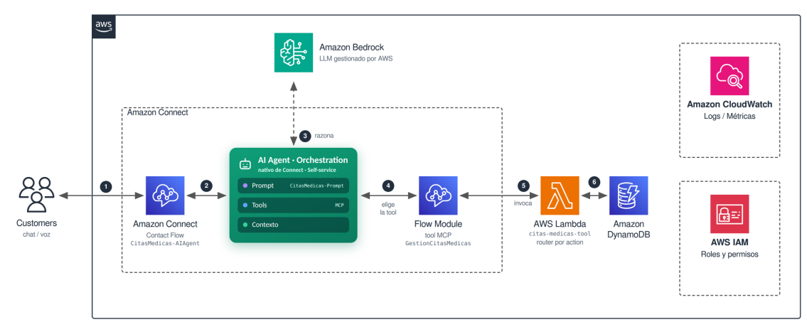
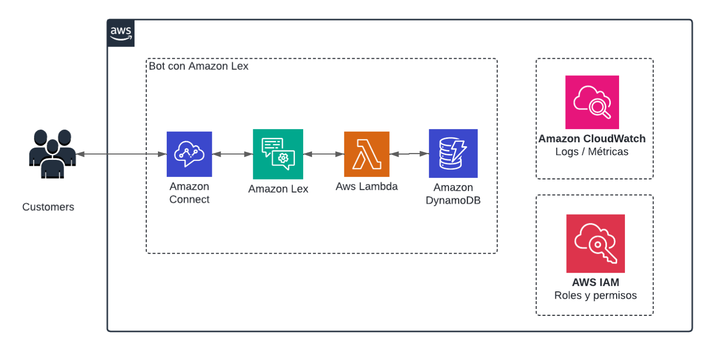

# De intents a prompts: agendamiento de citas médicas con Amazon Connect

> Proyecto presentado en la charla «De intents a prompts: construyendo agentes con Amazon Connect», en AWS Community Day Perú 2026 (3 de octubre de 2026, Salón Colaboratorio, Lima), por Sofía Torres y Yahaira Pérez.

**Idea central:** la transición de bots basados en intents y slots hacia agentes que razonan con prompts y usan herramientas. El mismo caso de uso, resuelto de dos formas: con Amazon Lex V2 y con Amazon Q in Connect.

<div align="center">

<br><em>Imagen ilustrativa: del menú de opciones a la conversación natural.</em>
</div>

---

## El caso de uso

Un asistente de citas médicas que permite:

- Consultar disponibilidad de horarios por especialidad y fecha.
- Agendar una cita (con un código tipo `CITA-1234`).
- Consultar una cita por documento de identidad.
- Reagendar y cancelar una cita por su código.

Ambas versiones ejecutan la misma lógica de negocio sobre AWS Lambda y DynamoDB. Es un prototipo con datos ficticios; el código es el que se usó en la charla y se configuró a mano en la consola de AWS, sin plantillas de despliegue automático.

---

## Dos versiones, la misma lógica

| | Versión con intents | Versión con agente |
|---|---|---|
| Servicio que conversa | Amazon Lex V2 | Amazon Q in Connect |
| Carpeta | [`lex-intents/`](lex-intents/) | [`agente-q-in-connect/`](agente-q-in-connect/) |
| Quién decide qué operación ejecutar | El intent que detecta Lex (cinco intents, como `AgendarCitaIntent`) | El agente, que elige la herramienta; la Lambda recibe un campo `action` |
| Si falta o falla un dato | La Lambda vuelve a pedir ese dato (`ElicitSlot`), con un reintento como máximo | La Lambda devuelve un mensaje con lo que falta o los horarios libres, y el agente continúa la conversación |
| Formato de entrada | Evento de Lex (`sessionState` con slots) | Parámetros del flujo de Connect (`Details.Parameters`) |
| Formato de salida | Respuesta de Lex (`ElicitSlot` o `Close`) | Diccionario plano de textos |

Lo que cambia entre las dos versiones es dónde vive la conversación. En la versión con intents, la Lambda se ocupa también de parte del manejo del diálogo. En la versión con agente, la Lambda se queda con las reglas de negocio y la conversación la guía el prompt.

### La misma conversación en las dos versiones

Se probó el mismo mensaje inicial en ambas:

<div align="center">

### La misma conversación en las dos versiones

Se probó el mismo mensaje inicial en ambas:

> Hola, quiero agendar una cita a mi nombre soy la paciente Sol, es urgente la necesito para hoy mismo.

<table>
  <tr>
    <td width="50%" align="center">
      
    </td>
    <td width="50%" align="center">
      
    </td>
  </tr>
</table>

El agente entendió el nombre, la urgencia y la fecha en el primer mensaje, pidió documento y especialidad en una sola pregunta y ofreció los horarios en lenguaje natural.

El bot con intents pregunta cada dato con una frase fija y no interpreta el mensaje libre como el agente: aunque la paciente ya había dicho su nombre, volvió a preguntarlo. La conversación permite un reintento adicional antes de cerrarse, según nuestra configuración; no es una limitación de Lex.

</div>

---
## Arquitectura

### Versión con agente

```text
Usuario
   │
   ▼
Chat (Amazon Connect)
   │
   ▼
Bot Lex puente
(sin lógica de intents propia; conecta con el agente)
   │
   ▼
AI Agent (Amazon Q in Connect)
   │  razonamiento y decisión
   ▼
Herramienta (Flow Module)
   │
   ▼
AWS Lambda
   │
   ▼
DynamoDB
```

<div align="left">

</div>

### Versión con intents

```text
Usuario
   │
   ▼
Chat (Amazon Connect)
   │
   ▼
Bot Lex V2 (intents y slots)
   │  fulfillment
   ▼
AWS Lambda
   │
   ▼
DynamoDB
```

<div align="left">

</div>

---

## Estructura del repositorio

```text
📦 Amazon-Connect-Intents-to-Prompts
├── 📁 lex-intents                # versión con Lex
│   ├── README.md
│   ├── lambda_function.py
│   └── 📁 assets
├── 📁 agente-q-in-connect        # versión con agente
│   ├── README.md
│   ├── lambda_function.py
│   └── 📁 assets
├── 📁 docs
│   ├── 📁 assets                 # imágenes de la documentación
│   ├── amazon-connect-setup.md   # configuración de Connect (versión con agente)
│   ├── prompt-agente.md          # prompt y reglas (versión con agente)
│   ├── tablas-dynamodb.md        # esquema de las tablas (común)
│   └── troubleshooting.md        # problemas y limitaciones (común)
└── README.md
```

---

## Empezar desde cero

Este proyecto se configuró a mano en la consola de AWS; no hay despliegue automático. Para reproducirlo:

### Paso 1. Crear las tablas de DynamoDB (común a las dos versiones)

→ **[Esquema de las tablas de DynamoDB](docs/tablas-dynamodb.md)**

### Paso 2. Elegir la versión que quieres reproducir

Cada versión tiene su propia guía, con su Lambda, su configuración en Amazon Connect y los documentos que necesita:

| Versión | Guía |
|---|---|
| Con agente (Amazon Q in Connect) | **[agente-q-in-connect/](agente-q-in-connect/README.md)** |
| Con intents (Amazon Lex V2) | **[lex-intents/](lex-intents/README.md)** |

### Paso 3. Si encuentras algún problema

→ **[Troubleshooting y limitaciones conocidas](docs/troubleshooting.md)**

---

## Alcance y limitaciones

- Es un prototipo con datos ficticios; no está listo para producción.
- No hay plantillas de infraestructura como código ni pruebas automatizadas en este repositorio.
- Las dos Lambdas no comparten código: cada una incluye su propia copia de la lógica de negocio.
- La versión del agente registra en los logs el evento completo que recibe, que incluye el documento del paciente. Con datos reales habría que quitarlo.
- En la versión con Lex, el código de la cita se genera al azar sin comprobar que no exista; la versión del agente sí lo comprueba.
- No se valida el formato ni la longitud del documento de identidad.
- No medí costos, latencia ni calidad de las respuestas del agente.

---

## Créditos

Proyecto desarrollado en conjunto para la charla.

- Versión con agente (Amazon Q in Connect): Yahaira Pérez.
- Versión con intents (Amazon Lex V2): Sofía Torres.
- Diseño, pruebas y documentación: trabajo compartido.

---

## Datos de prueba

> ⚠️ Este proyecto utiliza datos ficticios. No utilices información real de pacientes ni datos personales. Las credenciales de AWS no deben almacenarse en el repositorio.

---

Desarrollado por **Sofía Torres** · [LinkedIn](https://www.linkedin.com/in/sofia-torres-v/) y **Yahaira Pérez** · [LinkedIn](https://www.linkedin.com/in/yahaira-perez/) ✨