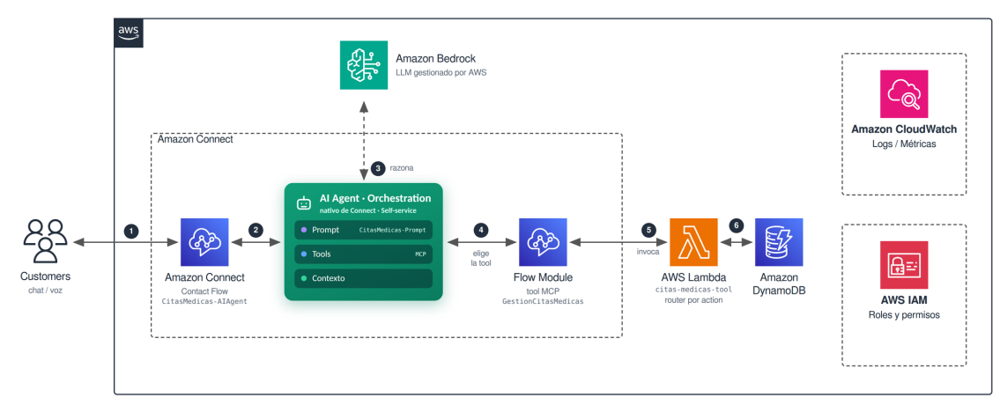
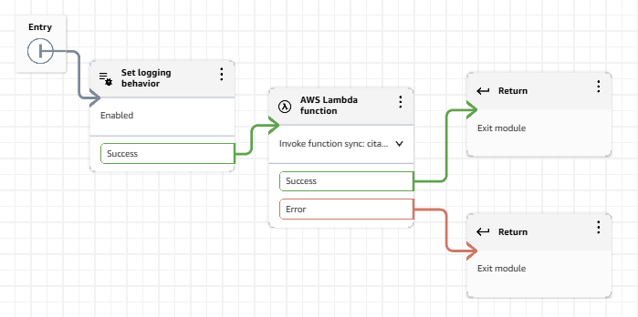
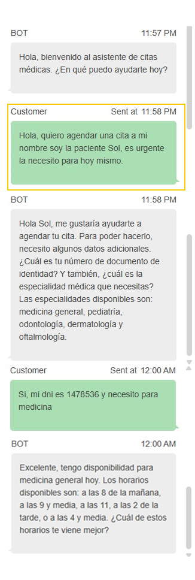

# Versión con agente (Amazon Q in Connect)

← [Volver al README principal](../README.md)

En esta versión, un agente de Amazon Q in Connect interpreta la conversación, decide qué herramienta usar y llama a una función Lambda que ejecuta la operación sobre DynamoDB. La conversación la guía el prompt, no un árbol de intents.

<div align="center">

</div>

## Cómo funciona

1. El cliente escribe en el chat de Amazon Connect.
2. El mensaje pasa por un bot de Lex que solo hace de puente hacia el agente.
3. El agente razona sobre el mensaje, recoge los datos que faltan conversando y decide qué acción ejecutar.
4. El agente invoca la herramienta (un Flow Module), que llama a la Lambda con un campo `action` y los parámetros.
5. La Lambda ejecuta la operación y devuelve un resultado, que el agente convierte en una respuesta natural.

## La herramienta (Flow Module)

La herramienta `GestionCitasMedicas` es un Flow Module de Amazon Connect que conecta al agente con la Lambda. El agente la invoca con un campo `action` y los parámetros que haya recogido en la conversación; la herramienta llama a la función y devuelve el resultado al agente, que lo convierte en una respuesta natural.



Parámetros que acepta (Input Schema):

| Parámetro | Tipo | Requerido |
|---|---|---|
| `action` | String | Sí |
| `especialidad`, `fecha`, `hora`, `documento`, `paciente`, `codigo_cita` | String | No |

El agente decide cuándo usarla leyendo la descripción del módulo, que documenta las cuatro acciones y los formatos que debe enviar. La configuración paso a paso está en [setup-agente.md](../docs/setup-agente.md).

## Cómo reproducirla

1. Crea las tablas de DynamoDB: [tablas-dynamodb.md](../docs/tablas-dynamodb.md).
2. Crea la función Lambda con el código de esta carpeta (ver la sección "La Lambda" más abajo).
3. Configura Amazon Connect y el AI Agent: [setup-agente.md](../docs/setup-agente.md). La Lambda debe existir antes, porque necesitas su ARN para la herramienta.
4. Configura el comportamiento del agente: [prompt-agente.md](../docs/prompt-agente.md).
5. Si algo falla, revisa [troubleshooting](../docs/troubleshooting.md).

## La Lambda

Código: [`lambda_function.py`](lambda_function.py)

La función recibe los parámetros en `Details.Parameters` (el formato del flujo de Connect) y ejecuta la acción indicada en `action`:

| `action` | Qué hace | Parámetros | En la herramienta del agente |
|---|---|---|---|
| `consultar_disponibilidad` | Muestra los horarios libres de una especialidad en una fecha | `especialidad`, `fecha` | Sí |
| `agendar_cita` | Agenda una cita y devuelve su código | `documento`, `especialidad`, `fecha`, `hora` (opcional: `paciente`) | Sí |
| `consultar_cita` | Consulta la cita más reciente confirmada de un paciente | `documento` | Sí |
| `reagendar_cita` | Cambia la fecha y la hora de una cita | `codigo_cita`, `fecha`, `hora` | No |
| `cancelar_cita` | Cancela una cita | `codigo_cita` | Sí |

La Lambda implementa las cinco acciones, pero la herramienta publicada expone cuatro: `reagendar_cita` no está disponible para el agente.

### Ejemplo de evento (datos ficticios)

```json
{
  "Details": {
    "Parameters": {
      "action": "consultar_disponibilidad",
      "especialidad": "odontologia",
      "fecha": "2026-11-05"
    }
  }
}
```

### Formato de la respuesta

Connect espera un diccionario plano de textos, así que la Lambda convierte todos los valores a texto (los booleanos pasan a `"true"` o `"false"` y las listas se unen con comas). Siempre incluye `ok` y `mensaje`:

```json
{
  "ok": "true",
  "mensaje": "Para odontologia el 2026-11-05 tengo: [horarios]. Cual prefieres?"
}
```

Configuración de la función:

| Elemento | Valor |
|---|---|
| Variables de entorno | `ESPECIALIDADES_TABLE`, `CITAS_TABLE` (opcionales; tienen valor por defecto) |
| Permisos | Lectura y escritura sobre las dos tablas y sus índices (ver [tablas-dynamodb.md](../docs/tablas-dynamodb.md)) |
| Permiso de invocación | Amazon Connect debe poder invocar la función |

## Prueba de la conversación

El mismo mensaje inicial se probó en las dos versiones:

> Hola, quiero agendar una cita a mi nombre soy la paciente Sol, es urgente la necesito para hoy mismo.



El agente entendió el nombre, la urgencia y la fecha en el primer mensaje, pidió documento y especialidad en una sola pregunta y ofreció horarios en lenguaje natural.

## Diferencias de comportamiento con la versión de Lex

| Aspecto | Versión con agente | Versión con Lex |
|---|---|---|
| Especialidad | Se normaliza (minúsculas y sin tildes) | Solo se pasa a minúsculas |
| Cancelar una cita | No comprueba el estado antes de cancelar | Comprueba que esté confirmada |
| Consultar una cita | Devuelve la más reciente confirmada | Devuelve la primera que encuentra |
| Código de cita | Comprueba que no exista (hasta 5 intentos) | No lo comprueba |

## Archivos exportados

Para no armar todo a mano, la carpeta [`exportados/`](exportados/) incluye los flujos de Amazon Connect de esta versión en formato JSON. Sirven como referencia y se pueden importar desde la consola de Connect.

| Archivo | Qué es |
|---|---|
| [`flow-module-tool-agente.json`](exportados/flow-module-tool-agente.json) | El Flow Module (la herramienta) que invoca la Lambda |
| [`flow-principal-agente.json`](exportados/flow-principal-agente.json) | El Contact Flow principal del chat, que conecta con el bot puente y el agente |

Los identificadores de cuenta, instancia, Lambda, bot y agente fueron reemplazados por marcadores (por ejemplo `<ARN_DE_LA_LAMBDA>`). Importar un flujo no recrea esos recursos: después de importarlo, vuelve a seleccionar tu propia Lambda, tu bot y tu dominio de Amazon Q in Connect.

## Limitaciones de esta versión

- La Lambda registra el evento completo en los logs, lo que puede incluir el documento del paciente.
- La fecha y la hora dependen de que el modelo respete el formato indicado en el prompt.
- El agente no tiene guardrails configurados en Amazon Q in Connect; las reglas de comportamiento viven solo en el prompt.
- La herramienta publicada expone cuatro acciones; `reagendar_cita` existe en la Lambda y en la versión con Lex, pero el agente no puede usarla.
- La lógica de negocio está repetida en esta Lambda y en la de la versión con Lex.
- Más detalle en [troubleshooting](../docs/troubleshooting.md).