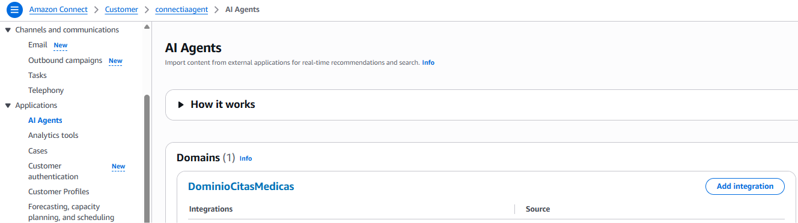
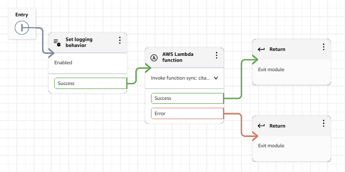
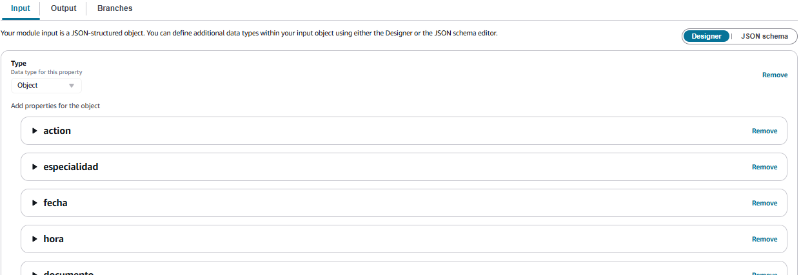
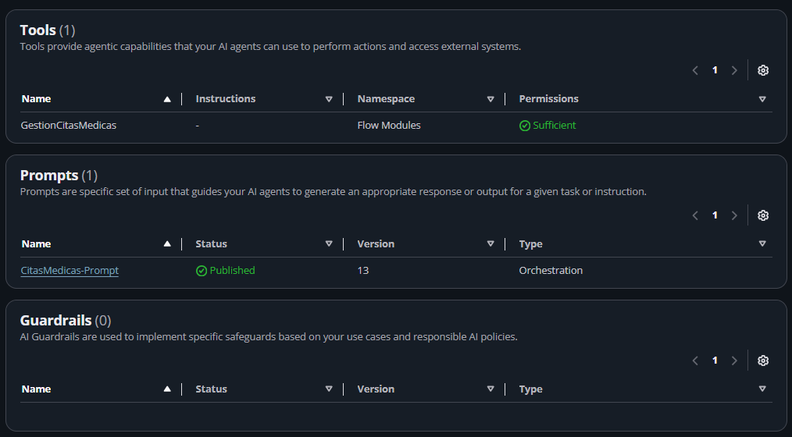
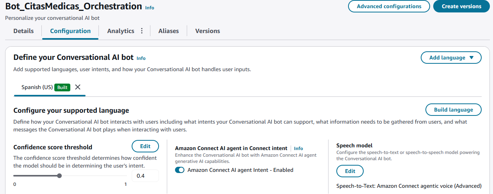
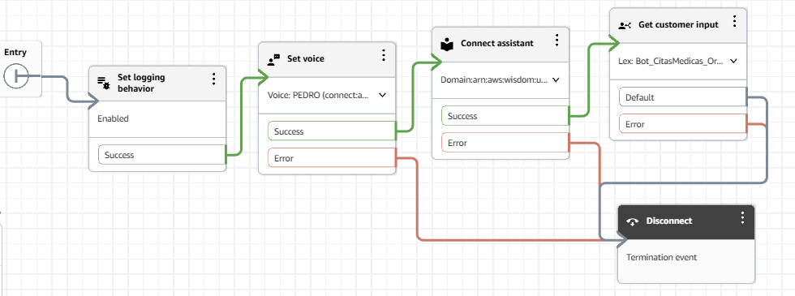

# Configuración en la consola de Amazon Connect (versión con agente)

Dado que la integración entre Amazon Connect, Lex V2 y Amazon Q in Connect tiene soporte limitado en infraestructura como código, estos pasos se realizan manualmente desde la consola web de AWS.

Para la versión con intents, consulta [lex-intents/](../lex-intents/).

En esta versión intervienen dos flujos distintos de Amazon Connect, que no deben confundirse:

- El **Flow Module** (paso 2) es la herramienta del agente: recibe la acción, invoca la Lambda y devuelve el resultado al agente.
- El **Contact Flow principal** (paso 6) es el flujo del chat: conecta al cliente con el bot puente y con el agente.

> Si prefieres no armarlo a mano, la herramienta y el flujo principal están en [`exportados/`](../agente-q-in-connect/exportados/). Después de importarlos, vuelve a seleccionar tu propia Lambda, tu bot y tu dominio, porque los identificadores de ese repositorio son marcadores.

---

## 1. Dominio de Amazon Q in Connect

1. En la consola de Amazon Connect, navega en el menú lateral izquierdo hacia **Applications → AI Agents**.
2. Confirma que en la sección **Domains** aparezca el dominio configurado (ejemplo: `DominioCitasMedicas`).
3. Si aún no existe un dominio, créalo seleccionando la integración correspondiente o desde la consola del servicio **Amazon Q in Connect**.

---

## 2. Flow Module (herramienta `GestionCitasMedicas`)

Este módulo funciona como la herramienta (Tool) del AI Agent para conectar la conversación con la función Lambda.

Aquí es donde se invoca la Lambda de la carpeta [`agente-q-in-connect/`](../agente-q-in-connect/). La rama de la izquierda del módulo (`AWS Lambda function`) debe terminar en bloques **`Return`** en ambas ramas (Success y Error). Eso es lo que permite que el resultado regrese al AI Agent en vez de hablarle directo al cliente:

1. Ve a **Flows → Modules → Add flow module**.
2. Nómbralo **`GestionCitasMedicas`**.
3. Configura el **Input Schema** (Settings → Input, tipo Object):
   - `action` (String, **requerido**)
   - `especialidad`, `fecha`, `hora`, `documento`, `paciente`, `codigo_cita` (Strings, opcionales).

   
4. **Diseño del módulo:**
   - Bloque `Set logging behavior` (Enabled).
   - Bloque `AWS Lambda function`: selecciona la función Lambda de la versión con agente (la de la carpeta `agente-q-in-connect/`).
   - Tanto la rama **Success** como **Error** deben finalizar en bloques **`Return`** *(no usar `MessageParticipant`, para que el resultado regrese al AI Agent)*.
5. En **Description** del módulo, documenta las 5 acciones, sus parámetros y los formatos obligatorios (ver [`prompt-agente.md`](prompt-agente.md)). El LLM lee este texto para decidir cómo invocar la herramienta.
6. Guarda y selecciona **Save → Save as tool**.

---

## 3. Permisos de perfil de seguridad

1. Ve a **Users → Security profiles → Admin** (o el perfil asignado).
2. Navega a **Channels and Flows → Flow modules**.
3. Asigna permiso de **Access** sobre la herramienta `GestionCitasMedicas`.
4. Haz clic en **Save** *(de lo contrario la herramienta mostrará el estado `Insufficient` en lugar de `Sufficient`)*. Si tras guardar sigue en `Insufficient`, recarga la página del agente (`Ctrl+F5`) o quita y vuelve a agregar la herramienta.

---

## 4. Configuración del AI Agent (Orchestration)

1. Ve a **Amazon Q in Connect → AI Agents → Create AI Agent**.
2. **Agent Type:** selecciona **Orchestration**. Es el único tipo compatible con el bloque nativo `Get customer input` (Self Service no lo soporta).
3. **Tools:** agrega la herramienta `GestionCitasMedicas` (`Add tool → Add existing AI Tool`), además de las herramientas base (`Complete` y `Escalate`). Mantén **desactivado** `User Confirmation` en la herramienta: la confirmación se maneja por prompt, no por este switch, porque la herramienta mezcla acciones de lectura y escritura.
4. **Prompt:** configura el System Prompt base y añade las reglas de negocio (ver [`prompt-agente.md`](prompt-agente.md)).
5. Haz clic en **Save** y luego en **Publish**.
6. **Copia el AI Agent ARN:**
   - Para pruebas rápidas en consola puede usarse el ARN terminado en `:$SAVED`, que refleja el último guardado sin necesidad de publicar en cada ajuste.
   - Para el flujo de demo usa el ARN que termina en el número de versión publicada (ejemplo: `...:ai-agent/...:1`). Da más estabilidad, porque `:$SAVED` puede seguir cambiando mientras editas el agente.

---

## 5. Bot puente de Amazon Lex V2

1. Ve a **Flows → Conversational AI → Create bot** (por ejemplo, `Bot_CitasMedicas_Orchestration`).
2. Idioma: **Spanish (US)**.
3. En la configuración del idioma, activa el switch **"Amazon Connect AI agent intent"**.
4. *Nota:* este bot no requiere que definas intents ni slots propios. Al activar el switch se genera un intent para el AI Agent, y el bot actúa únicamente como canal puente hacia él.
5. Haz clic en **Build**.

---

## 6. Contact Flow principal

Este es el flujo del chat, distinto del Flow Module del paso 2.

Ve a **Flows → Create flow** y conecta los bloques en la siguiente secuencia:

| # | Bloque | Configuración |
|---|---|---|
| 1 | **Set logging behavior** | Enabled |
| 2 | **Set voice** | Spanish (US) (por ejemplo, Pedro o Fernanda) |
| 3 | **Connect assistant** | Selecciona el dominio de Q in Connect (paso 1) |
| 4 | **Get customer input** | Selecciona el bot de Lex (`Bot_CitasMedicas_Orchestration`, paso 5). Agrega el **Session Attribute** manual: Key `x-amz-lex:q-in-connect:ai-agent-arn`, Value = ARN publicado del AI Agent (paso 4) |
| 5 | **(opcional) Set working queue → Transfer to queue** | Para derivar a un agente humano |
| 6 | **Disconnect** | Finalización de todos los caminos de error y de fin |

**Save** y **Publish**.

---

[← Volver al README principal](../README.md)