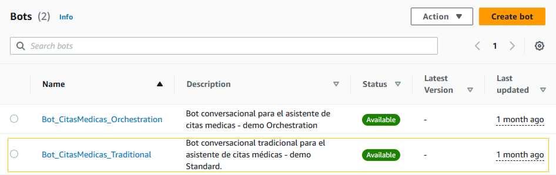
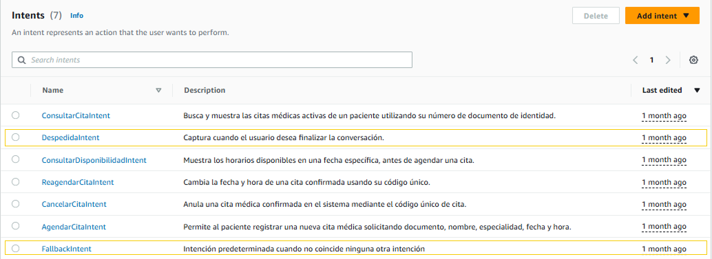
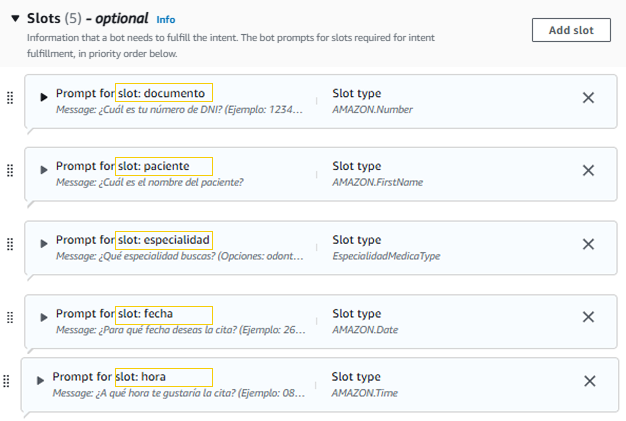
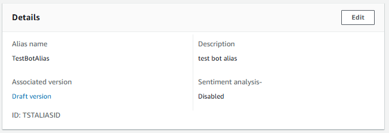
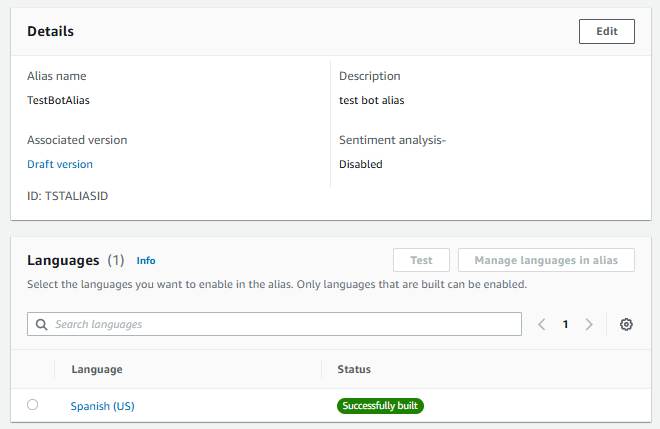
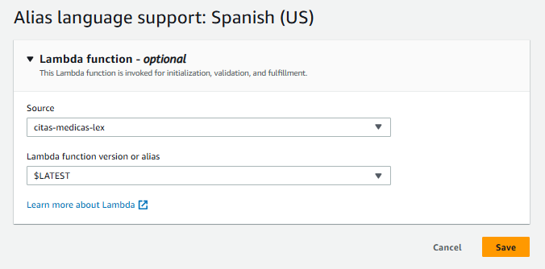
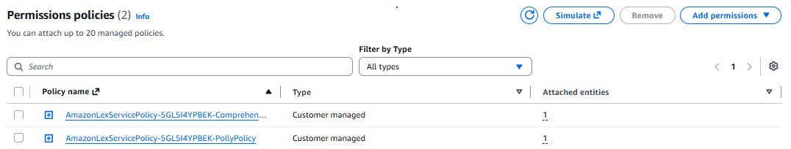
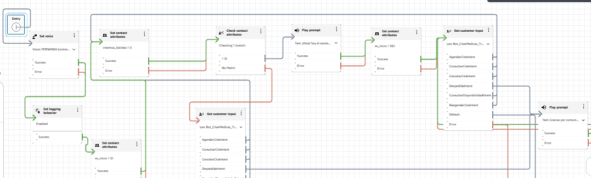

# Configuración del bot de Lex y su conexión a Amazon Connect (versión con intents)

← [Volver al README principal](../README.md)

Estos pasos se realizan manualmente desde la consola de AWS. Los nombres de los menús pueden variar un poco según la versión de la consola.

Antes de empezar, necesitas las tablas de DynamoDB ([tablas-dynamodb.md](tablas-dynamodb.md)) y la función Lambda con el código de [`lex-intents/lambda_function.py`](../lex-intents/lambda_function.py). Para la versión con agente, consulta [setup-agente.md](setup-agente.md).

> El flujo de contacto de esta versión está en [`exportados/`](../lex-intents/exportados/). Si lo importas, vuelve a seleccionar tu propio bot y alias, porque los identificadores de ese repositorio son marcadores.

---

## 1. Crear el bot

1. En la consola de AWS, abre **Amazon Lex**.
2. Ve a **Bots → Create bot** y elige crear un bot en blanco.
3. Ponle nombre (en este proyecto, `Bot_CitasMedicas_Traditional`) y deja que Lex cree un rol de IAM con los permisos básicos.
4. Elige el idioma en el que vas a conversar con el cliente (español).

---

## 2. Crear los intents

En el idioma del bot, agrega estos seis intents. Los nombres deben ser exactamente estos, porque la Lambda decide qué operación ejecutar según el nombre del intent:

| Intent | Qué hace |
|---|---|
| `AgendarCitaIntent` | Agenda una cita |
| `ConsultarCitaIntent` | Consulta la cita de un paciente |
| `CancelarCitaIntent` | Cancela una cita |
| `ConsultarDisponibilidadIntent` | Muestra horarios libres |
| `ReagendarCitaIntent` | Cambia fecha y hora de una cita |
| `DespedidaIntent` | Despide al paciente (no usa la Lambda) |

A cada intent agrégale **sample utterances**, las frases con las que el cliente suele pedir esa operación. Es lo que Lex usa para reconocer el intent.

---

## 3. Crear los slots

Cada intent pide los datos que le faltan mediante slots. Los nombres deben coincidir con los que lee la Lambda:

| Intent | Slots |
|---|---|
| `AgendarCitaIntent` | `documento`, `paciente`, `especialidad`, `fecha`, `hora` |
| `ConsultarCitaIntent` | `documento` |
| `CancelarCitaIntent` | `codigo_cita` |
| `ConsultarDisponibilidadIntent` | `especialidad`, `fecha` |
| `ReagendarCitaIntent` | `codigo_cita`, `fecha`, `hora` |

`DespedidaIntent` no usa slots.

Para cada slot configura:

- El **tipo de slot**, que define qué valores acepta Lex (la captura de arriba muestra los que se usaron).
- El **prompt**, la pregunta que Lex hace al cliente para pedir ese dato.
- Si es **requerido**.

Un detalle importante: la Lambda solo pasa la especialidad a minúsculas y la busca tal cual en DynamoDB. Por eso el slot `especialidad` debe devolver el nombre exacto, sin tilde (por ejemplo `pediatria`), como está guardado en la tabla.

---

## 4. Conectar la Lambda como fulfillment

1. Crea una **versión** del bot y un **alias**.

2. En el alias, abre el idioma y asigna la función Lambda.

3. En cada intent de operación (todos menos `DespedidaIntent`), activa el uso de la Lambda para el fulfillment.

4. Comprueba que Lex tenga permiso para invocar la función. Normalmente la consola lo agrega al asignarla.

La Lambda responde a Lex de dos formas: pide de nuevo un slot (`ElicitSlot`) o cierra la conversación con el mensaje final (`Close`). Vuelve a preguntar un slot una sola vez.

---

## 5. Construir el bot

Haz clic en **Build**. Cuando termine, puedes probarlo desde el panel de prueba de Lex antes de conectarlo a Connect.

---

## 6. Conectar el bot a Amazon Connect

1. Asegúrate de que el bot esté habilitado para tu instancia de Amazon Connect, en la configuración de la instancia (sección de Amazon Lex).
2. Ve a **Flows → Create flow** (en este proyecto, `CitasMedicas-LexBot`) y arma esta secuencia:

| # | Bloque | Configuración |
|---|---|---|
| 1 | **Set voice** y **Set logging behavior** | Idioma Spanish (US), voz Fernanda, y logging en Enabled |
| 2 | **Set contact attributes** | `es_inicio = SI` e `intentos_fallidos = 0` |
| 3 | **Check contact attributes** (`es_inicio`) | Si vale `SI`, envía el mensaje de bienvenida y cambia `es_inicio` a `NO`; si no, va directo al bot |
| 4 | **Get customer input** (el bot) | Selecciona el bot (`Bot_CitasMedicas_Traditional`) y su alias de prueba. La primera vez pregunta "¿En qué puedo ayudarte hoy?"; las siguientes, "¿Algo más en lo que pueda ayudarte?" |
| 5 | Una rama por cada intent | Los intents de operación ponen `intentos_fallidos` en 0 y vuelven al bot. `DespedidaIntent` envía el mensaje de despedida y termina |
| 6 | Si el bot no reconoce el intent | Compara `intentos_fallidos`: la primera vez envía "No entendí tu solicitud" y vuelve a preguntar; si ya había fallado antes, avisa del problema y desconecta |
| 7 | **Disconnect** | Final de todos los caminos |

3. Guarda, publica el flujo y pruébalo con **Test chat**.

A diferencia de la versión con agente, este flujo no lleva el bloque **Connect assistant** ni el atributo de sesión con el ARN del agente, porque no usa Amazon Q in Connect.

---

## 7. Probar

Usa el mismo mensaje inicial que en la versión con agente, para poder comparar:

> Hola, quiero agendar una cita a mi nombre soy la paciente Sol, es urgente la necesito para hoy mismo.

Si algo falla, revisa [troubleshooting](troubleshooting.md).

---

[← Volver al README principal](../README.md)