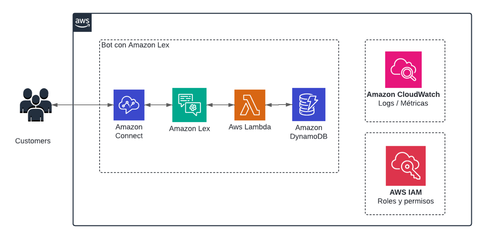
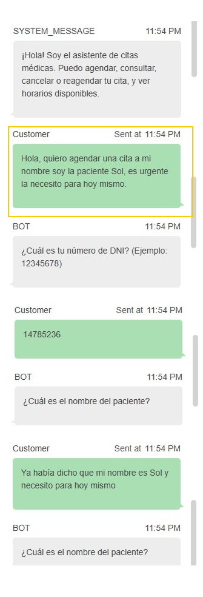

# Versión con intents (Amazon Lex V2)

← [Volver al README principal](../README.md)

En esta versión, un bot de Amazon Lex V2 detecta qué quiere el cliente (intent), recoge los datos que faltan (slots) y llama a una función Lambda para ejecutar la operación sobre DynamoDB.

## Cómo funciona

1. El cliente escribe en el chat de Amazon Connect.
2. El bot de Lex detecta el intent y pregunta, uno por uno, los slots que faltan.
3. Cuando tiene los datos, Lex invoca la Lambda (fulfillment) con el intent y los valores de los slots.
4. La Lambda ejecuta la operación y responde a Lex con el mensaje para el cliente.

## Cómo reproducirla

1. Crea las tablas de DynamoDB: [tablas-dynamodb.md](../docs/tablas-dynamodb.md).
2. Crea la función Lambda con el código de esta carpeta (ver la sección "La Lambda" más abajo).
3. Configura el bot de Lex y conéctalo a Amazon Connect: [setup-lex.md](../docs/setup-lex.md).
4. Si algo falla, revisa [troubleshooting](../docs/troubleshooting.md).

## Intents y slots

| Intent | Qué hace | Slots que usa |
|---|---|---|
| `AgendarCitaIntent` | Agenda una cita | `documento`, `paciente` `especialidad`, `fecha`, `hora` |
| `ConsultarCitaIntent` | Consulta la cita de un paciente | `documento` |
| `CancelarCitaIntent` | Cancela una cita | `codigo_cita` |
| `ConsultarDisponibilidadIntent` | Muestra horarios libres | `especialidad`, `fecha` |
| `ReagendarCitaIntent` | Cambia fecha y hora de una cita | `codigo_cita`, `fecha`, `hora` |
| `DespedidaIntent` | Despide al paciente; no usa la Lambda, el flujo de Connect envía el mensaje y termina | ninguno |

Los nombres de intents y slots son los que la Lambda espera. Si los cambias en Lex, cámbialos también en el código.

La configuración paso a paso, con capturas, está en [setup-lex.md](../docs/setup-lex.md).

## La Lambda

Código: [`lambda_function.py`](lambda_function.py)

- Lee el nombre del intent y los valores de los slots del evento de Lex (`sessionState`).
- Ejecuta la operación que corresponde al intent y devuelve un mensaje.
- Si falta o falla un dato (por ejemplo, un horario ocupado), pide de nuevo ese slot con `ElicitSlot`. Vuelve a preguntar una sola vez (`MAX_REINTENTOS = 1`); después cierra la conversación con el mensaje.
- Valida que el código de cita tenga el formato `CITA-1234` antes de buscarlo.

Configuración de la función:

| Elemento | Valor |
|---|---|
| Variables de entorno | `ESPECIALIDADES_TABLE`, `CITAS_TABLE` (opcionales; tienen valor por defecto) |
| Permisos | Lectura y escritura sobre las dos tablas y sus índices (ver [tablas-dynamodb.md](../docs/tablas-dynamodb.md)) |
| Permiso de invocación | El bot de Lex debe poder invocar la función |

## Prueba de la conversación

El mismo mensaje inicial se probó en las dos versiones:

> Hola, quiero agendar una cita a mi nombre soy la paciente Sol, es urgente la necesito para hoy mismo.

Con esta configuración, el bot pide cada dato con su frase fija (documento, nombre del paciente) y no interpreta el mensaje libre como lo hace el agente: aunque el cliente ya haya dicho su nombre, el bot volvió a preguntarlo. Es un comportamiento de esta configuración y de sus reintentos, no una limitación general de Lex.

## Cómo conectarlo a Amazon Connect

El bot de Lex no atiende solo: se usa dentro de un flujo de contacto de Amazon Connect, igual que en la versión con agente. A diferencia de esa versión, el flujo no lleva el bloque Connect assistant ni el atributo de sesión con el ARN del agente. Los pasos están en [setup-lex.md](../docs/setup-lex.md).

## El flujo de contacto

El flujo de Amazon Connect (`CitasMedicas-LexBot`) hace más que conectar el chat con el bot:

- Da la bienvenida una sola vez y después pregunta "¿Algo más en lo que pueda ayudarte?" tras cada operación.
- Cuando Lex detecta `DespedidaIntent`, envía un mensaje de despedida y termina la conversación.
- Si Lex no reconoce ningún intent, avisa y vuelve a preguntar una vez; si vuelve a fallar, avisa del problema y desconecta.

## Archivos exportados

La carpeta [`exportados/`](exportados/) incluye el flujo de contacto de Amazon Connect de esta versión en formato JSON, como referencia o para importarlo desde la consola de Connect.

| Archivo | Qué es |
|---|---|
| [`flow-principal-lex.json`](exportados/flow-principal-lex.json) | El Contact Flow que conecta el chat con el bot de Lex |

Los identificadores de cuenta, instancia, Lambda, bot y agente fueron reemplazados por marcadores (por ejemplo `<ARN_DE_LA_LAMBDA>`). Importar un flujo no recrea esos recursos: después de importarlo, vuelve a seleccionar tu propia Lambda y tu bot.

## Limitaciones de esta versión

- La lógica de negocio está repetida en esta Lambda y en la de la versión con agente.
- El código de cita se genera al azar sin comprobar que no exista.
- Hay una condición de carrera al agendar. Más detalle en [troubleshooting](../docs/troubleshooting.md).